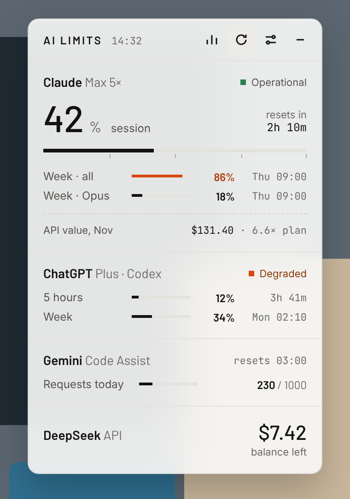
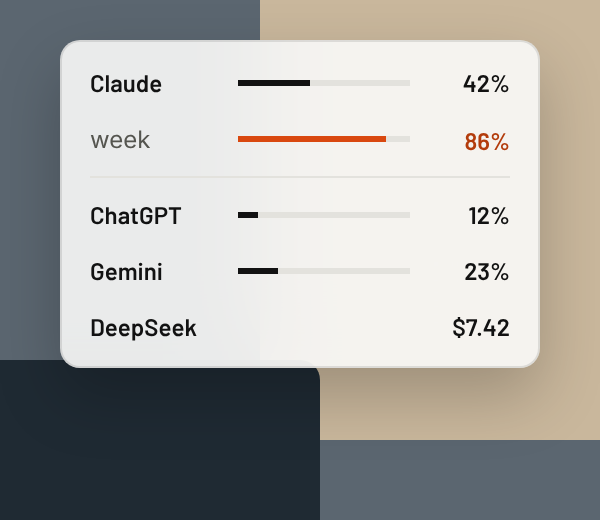
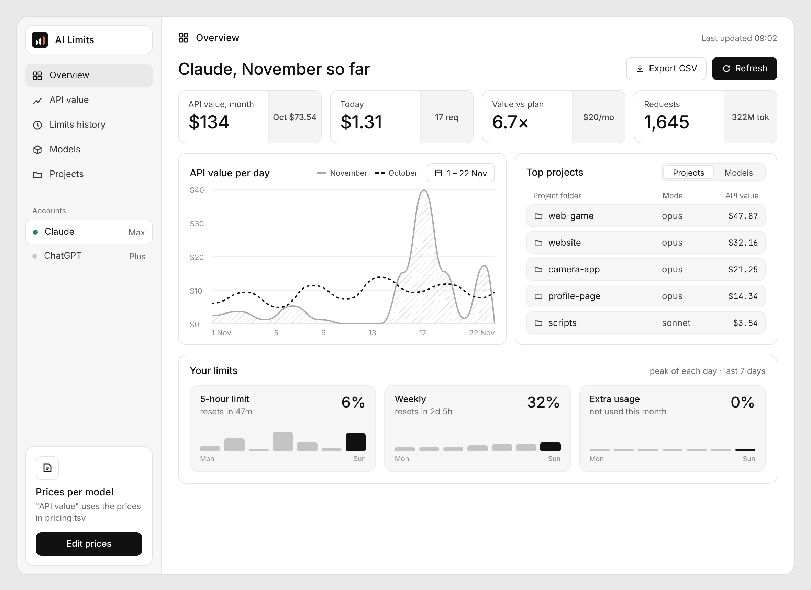
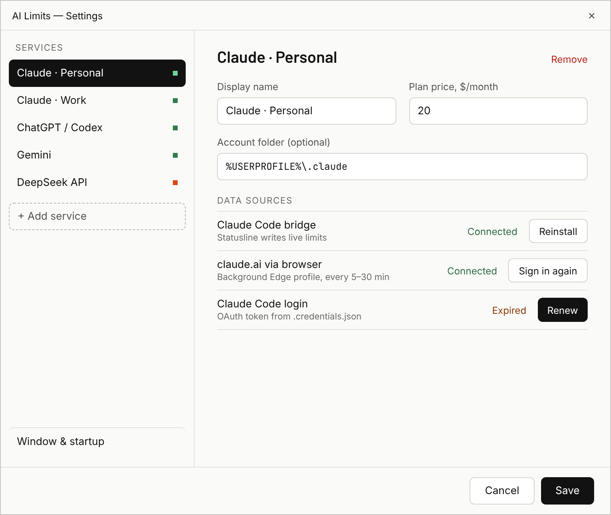

# AI Limits

A small always-on-top Windows widget that shows how much of your AI subscriptions and API budgets is left: Claude, ChatGPT / Codex, Gemini, DeepSeek and others, in one place.

It is a single PowerShell script with WinForms — no installer, no runtime to download, nothing leaves your computer except the requests to the services themselves.

  
  &nbsp;
  

  

  

Screenshots are design renders with sample data.

## Features

- **Subscription limits** — Claude (session, weekly, Opus), ChatGPT / Codex (5-hour and weekly windows), Gemini Code Assist (daily requests), with time until reset.
- **API balances and budgets** — DeepSeek and OpenRouter balances, Anthropic / OpenAI spend against a monthly budget you set, or any custom JSON endpoint.
- **API value of your subscription** — reads local Claude Code and Codex logs and shows what the same usage would cost on the API, with a breakdown by model and by project.
- **Statistics window** — a dashboard with pages for Overview, API value (this month against last month), Limits history (daily peaks for the last 7 days), Models and Projects, plus CSV export.
- **Service status** — a small marker when status.claude.com / status.openai.com report an incident.
- **Several accounts** — e.g. a personal and a work Claude account side by side.
- **Stays out of the way** — hides in games and fullscreen apps, global hotkey (Ctrl+Alt+L by default), compact mode (double-click the widget), tray icon.
- **Connect automatically** — a wizard finds what is already on the PC (Claude Code, Codex CLI, Gemini CLI, API keys in environment variables) and runs the official sign-in commands only after you confirm them.

## Requirements

- Windows 10 or 11
- Windows PowerShell 5.1 (built in)
- Optional: Claude Code, Codex CLI or Gemini CLI if you want subscription limits for those services; Edge or Chrome for reading claude.ai limits in the background

## Install

1. Download this repository (**Code → Download ZIP**) and unzip it somewhere permanent, e.g. `Documents\AI Limits`.
   If Windows marks the files as downloaded from the internet: right-click the ZIP → **Properties** → **Unblock** before unzipping.
2. Double-click **`Setup.cmd`**.
   It compiles a tiny `AI Limits.exe` launcher with the C# compiler that ships with Windows, adds Start menu and desktop shortcuts and starts the widget.
3. Open **Settings → Connect automatically…** and follow the steps, or add services by hand with **+ Add service**.

If something does not start, run **`Start (debug).bat`** — it opens a console that shows the error.

## How the data is read

| Service | Source |
|---|---|
| Claude (subscription) | Claude Code status line bridge → claude.ai through a separate background browser profile → claude.ai session key → Claude Code OAuth usage endpoint |
| ChatGPT / Codex | Codex CLI sign-in (`~/.codex/auth.json`) → ChatGPT usage endpoint |
| Gemini | Gemini CLI sign-in → Code Assist quota endpoint |
| DeepSeek, OpenRouter | API key → balance / credits endpoint |
| Anthropic / OpenAI API | Admin key → cost report, compared with your monthly budget |
| Custom | Any JSON endpoint: URL, header, and JSON paths for value and total |

The widget polls claude.ai adaptively: every 3 minutes while usage changes, then 5 → 10 → 20 → 30 minutes when nothing changes, and half as often on battery. The refresh button always checks immediately.

## Privacy

- Settings live in `%APPDATA%\AILimits\config.json`. Keys and session tokens are encrypted with Windows DPAPI, so they can only be read by your Windows account on this PC. The file is saved atomically and a `config.json.bak` copy is kept.
- Usage statistics are computed locally from Claude Code / Codex logs and stored in `%APPDATA%\AILimits\usage\`.
- No telemetry. The only network requests go to the services you add and to their public status pages.
- Sign-in commands and token renewals are shown to you and run only after you click **Run**.

## Files

| Path | What it is |
|---|---|
| `AILimits.ps1` | The whole app |
| `Setup.cmd` | First run: builds the launcher and shortcuts |
| `Start (debug).bat` | Runs the app with a visible console for troubleshooting |
| `%APPDATA%\AILimits\pricing.tsv` | Per-model API prices used for "API value" (editable from Statistics → Edit prices) |
| `%APPDATA%\AILimits\error.log` | Error log |

## Notes

- Usage endpoints for subscriptions are not official public APIs and may change without notice.
- "API value" only covers work done through Claude Code and Codex on this PC; chats on claude.ai or chatgpt.com are not included.
- Prices in `pricing.tsv` are a starting point; check them against the providers' current pricing pages.

## License

[MIT](LICENSE)
